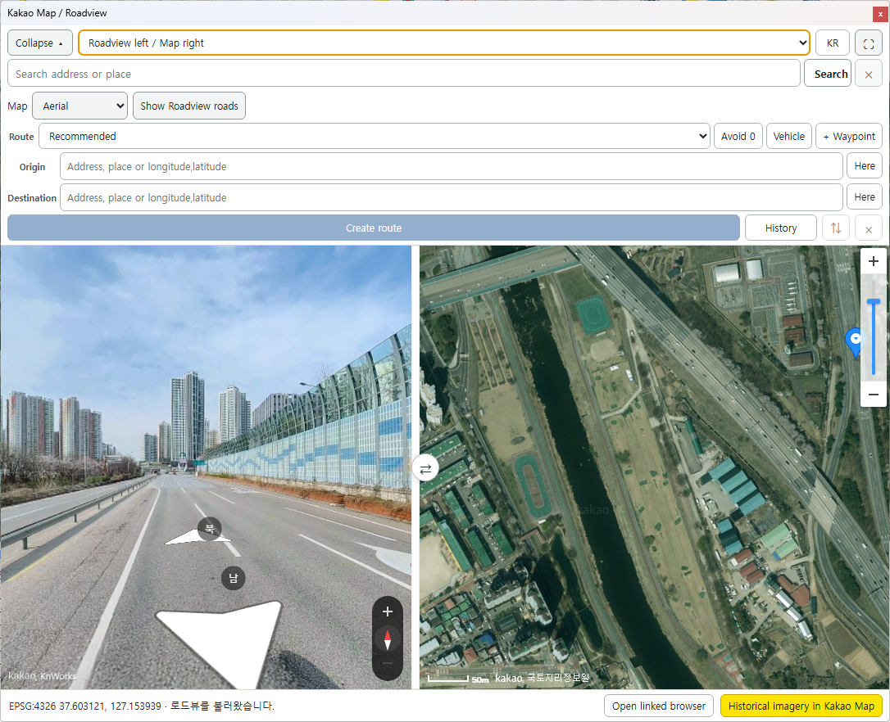

# Kakao QGIS Bridge

[한국어](README.md) · [English](README.en.md)

Synchronize QGIS with Kakao Map and Roadview, including map position and zoom. The viewer runs in a dock when Qt WebEngine/WebChannel is available and in an external browser otherwise.

**Released version: 1.3 (2026-10-23).** The [English release notes](docs/release-notes.en.md) also document the separate 1.3.1 development candidate, whose independent panel-collapse behavior was confirmed by the user on October 27, 2026.

## Install and start

1. Install the distribution ZIP through QGIS **Manage and Install Plugins → Install from ZIP**, restart QGIS, and enable **Kakao QGIS Bridge**.
2. Register `http://localhost:8081` and `http://localhost:8082` as JavaScript SDK domains for your Kakao JavaScript key.
3. Open **Kakao Map / Roadview** and enter your JavaScript key. Enter your REST API key when creating your first driving route.

Each user supplies their own keys. See the [English setup and usage guide](docs/guide.en.md).

## Features

- Bidirectional QGIS/Kakao Map position and zoom synchronization, with Roadview position and direction display.
- Place/address search, map types, and Roadview road coverage overlay.
- Driving routes with up to five waypoints, avoidance and vehicle options, and turn-by-turn guidance.
- Route history import and GeoPackage, GeoJSON, Shapefile, and GPX export.
- Read-only comparison of Kakao/Naver GPKG routes, including distance, duration, tolls, and estimated taxi fares.
- Collapsible explorer, vertical/horizontal layouts, fullscreen, and English/Korean viewer controls.

## Compatibility and verification

Declared support covers QGIS 3.34+ and QGIS 4 / Qt 6. QGIS 3.34 has not been runtime-tested. On 2026-10-23, the user confirmed functionality in QGIS 3.44 and rechecked existing functionality in QGIS 4. Development runtime checks used Windows QGIS 3.44.14 / 4.2.2; this does not establish coverage of every operating system or runtime combination.

## Limits

History is kept in memory and is **not saved automatically**. Export it before exiting. Prefer GeoPackage or GeoJSON to preserve complete attributes; Shapefile can truncate long text and waypoint information.

Kakao uses discrete zoom levels, so arbitrary QGIS scales may not match exactly. Zoom-only changes preserve the Roadview capture position. Language switching covers the main viewer controls; SDK place names, QGIS menus/dialogs, and some status messages remain unchanged.

API keys are stored unencrypted in QGIS settings. External browser session tokens appear in the viewer URL. Kakao maps are embedded through the SDK rather than registered as QGIS XYZ/TMS layers.

## Documentation

- [Setup and usage (English)](docs/guide.en.md)
- [Release notes (English)](docs/release-notes.en.md)
- [Full changelog (Korean)](CHANGELOG.md)
- [Illustrated usage guide](docs/usage.md)
- [Development and tests (Korean)](docs/development.md)
- [Release checklist (Korean)](docs/release-checklist.md)

## License

[GPL-2.0-or-later](LICENSE). Kakao Maps and Mobility APIs are subject to their providers' terms and quotas. This is an independent project, not an official Kakao product. API keys and map tiles are not distributed with the plugin.
