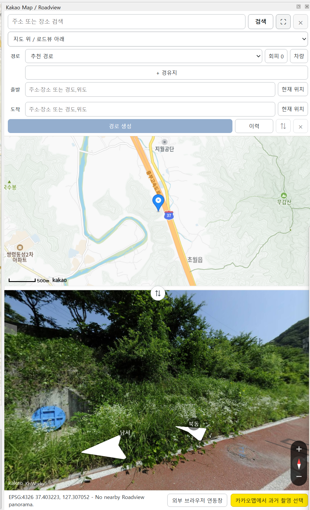
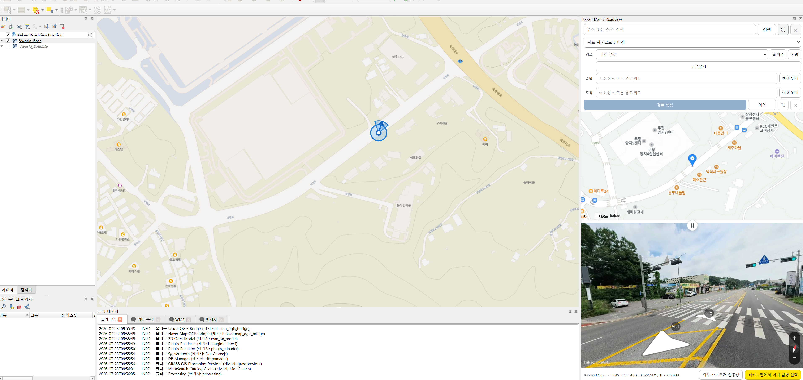
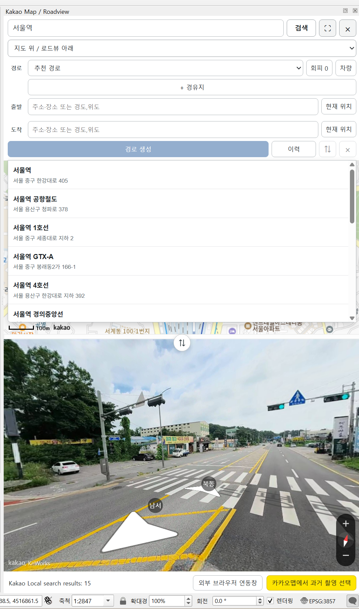
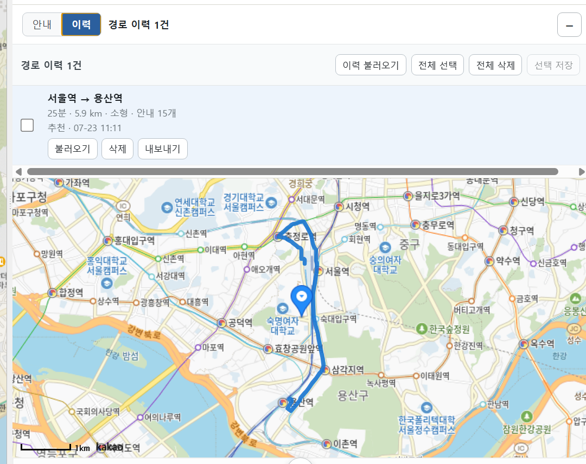
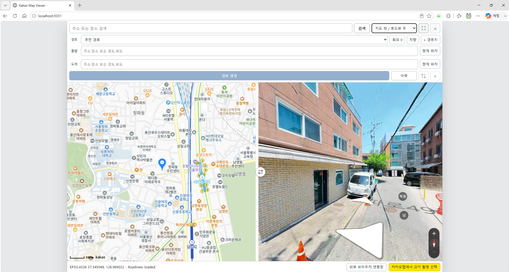

# Kakao QGIS Bridge

QGIS와 Kakao Map·Roadview를 연결하는 플러그인입니다. QGIS 3.34 이상(3.34는 미검증)과 QGIS 4 / Qt 6 환경을 대상으로 합니다. 버전별 변경사항은 [CHANGELOG](CHANGELOG.md), 자세한 사용법은 [사용 가이드](docs/usage.md)를 참고하세요.

이 플러그인은 Kakao 지도 타일 URL을 추출하거나 QGIS XYZ/TMS 배경지도로 등록하지 않습니다. WebEngine이 있으면 QGIS 도크에서, 없으면 외부 브라우저에서 Kakao Maps JavaScript API를 표시합니다. QGIS 캔버스 중심 좌표를 EPSG:4326으로 변환해 Kakao Map과 Roadview 중심으로 전달합니다.



## 화면 예시

자세한 화면별 사용 흐름은 [docs/usage.md](docs/usage.md)를 참고하세요.

### 위치 동기화와 검색

상단 **탐색창 접기 / 펼치기**로 검색·지도 설정·경로 입력·안내/이력 영역 전체를
숨기고 다시 열 수 있습니다. 입력값과 탐색 결과를 유지하며 지도·로드뷰 공간을 넓힙니다.

도크를 처음 분리하면 화면 가용 영역 안에서 1100×850 논리 픽셀을 기준으로 넓게 엽니다.
작은 화면에서는 화면 안으로 크기를 제한하며, 이후 직접 조절한 분리 창 크기는 강제로 되돌리지 않습니다.
세로 배치에서는 탐색창을 제외한 남은 공간을 지도와 로드뷰가 분할합니다.

개발 후보 1.2.2에서는 검색창 아래 **지도** 선택으로 일반지도·항공영상·항공영상+지명을
전환하고, **로드뷰 도로 표시** 버튼으로 촬영 도로 선을 켜고 끌 수 있습니다.
플러그인 지도에만 적용되며 QGIS 배경지도는 바꾸지 않습니다. 전환 자체는 지도 중심·줌이나
로드뷰 촬영 위치를 변경하지 않습니다. 촬영 도로 표시는 촬영일 표시 기능이 아닙니다.

QGIS와 Kakao Map은 지도 이동과 확대·축소를 양방향으로 동기화합니다. 확대·축소만 할 때는 Roadview 촬영 위치와 위치 마커를 유지하며, 지도 드래그나 Roadview 내부 이동 시에는 위치도 따라갑니다. Kakao의 확대 단계가 이산적이므로 임의의 QGIS 축척과 완전히 일치하지 않을 수 있습니다.



Kakao Local 검색으로 장소명과 주소를 찾고, 검색 결과를 선택해 QGIS와 Kakao Map/Roadview를 같은 위치로 이동할 수 있습니다.

검색 후 검색창 아래의 **검색 결과 N개 접기 / 펼치기**로 목록을 숨기거나 다시 열 수 있습니다.
목록을 접어도 결과는 유지되며 새 검색 시에는 새 목록이 자동으로 펼쳐집니다.



### 경로 탐색과 안내

출발지, 도착지, 경유지, 경로 유형, 회피 옵션, 차량 설정을 입력해 Kakao Mobility 자동차 경로를 생성합니다. 결과는 QGIS 임시 경로 레이어, 출발지·도착지·경유지 핀, 순서별 안내 포인트로 표시됩니다. 탐색 후 핀은 API 안내 좌표를 기준으로 표시하며 원래 입력 좌표는 편집·재검색·이력 저장용으로 보존합니다. 경로 결과에 경유지 안내가 없으면 해당 경유지 결과 핀은 표시하지 않습니다. 현재 안내 레이어의 작은 출발·도착·경유 핀은 숨겨 큰 Route Points 핀과 겹치지 않도록 하고, 회전·유턴 안내는 유지합니다.


안내 목록에서 항목을 선택하면 Kakao Map/Roadview가 해당 안내 지점으로 이동하고 QGIS에서도 대응 피처가 선택됩니다.


### 이력과 외부 연동

플러그인 메뉴의 **GPKG 경로 비교...**에서 카카오·네이버 GPKG 파일을 A/B로 열고 각 파일의 경로를 선택할 수 있습니다. 거리·소요 시간·조회 시점과 B−A 차이를 표시하며 출발·도착점이 20m를 초과해 다르거나 경유지가 다르면 안내합니다. 소요 시간은 서비스별 조회 당시 예측값입니다. **두 경로 지도에 표시**는 A를 파랑 실선, B를 주황 점선으로 표시합니다. 경로를 다시 선택하면 이전 비교 표시를 지우며 **비교 표시 지우기**로도 제거할 수 있습니다. 비교는 원본 파일과 카카오 세션 이력을 수정하지 않습니다. 현재 `kakao_route_history` 또는 `naver_route_history` 레이어가 있는 EPSG:4326 GPKG를 지원합니다.

경로 검색 결과는 현재 세션의 이력 탭에 누적됩니다. 이력은 다시 불러오거나 삭제하거나 GeoPackage, GeoJSON, Shapefile, GPX로 내보낼 수 있습니다.

개발 후보 1.2.2에서는 통행료·예상 택시요금을 저장하고 GPKG 비교표에 A/B 금액과 차액을
표시합니다. 요금 없는 기존 파일은 ‘정보 없음’이며 소급 복원하지 않습니다. 카카오·네이버
플러그인의 요금 저장 기능으로 새로 조회한 뒤 별도 파일로 내보내세요. 실제 청구액을
보장하지 않습니다. [요금 비교 안내](docs/fare-comparison.md)

프로젝트를 새로 만들거나 다른 프로젝트로 전환하면 현재 경로·안내·입력 핀과 이전 경로 요청은 초기화됩니다. 세션 이력은 유지되며 이력 탭에서 선택하면 새 프로젝트에 다시 표시할 수 있습니다. 표시 레이어 하나를 삭제하는 동작은 프로젝트 전환과 구분합니다.



QGIS 3처럼 Qt WebEngine을 사용할 수 없는 환경에서는 외부 브라우저 연동 모드로 같은 Kakao Viewer를 사용할 수 있습니다.



## 현재 단계

- Plugin Builder 없는 최소 QGIS 플러그인 구조
- QGIS 메뉴/툴바 액션 등록
- Dock Widget 생성
- Dock 내부 `QWebEngineView` 표시
- Kakao Maps JavaScript API 지도 로드
- QGIS 캔버스 중심 좌표를 EPSG:4326으로 변환
- QGIS↔Kakao Map 양방향 이동·확대·축소 연동; 줌만 할 때 Roadview 촬영 위치 유지
- Kakao 지도 위 마우스 휠과 확대·축소 버튼 지원; 실제 지상 거리/픽셀 기준으로 가장 가까운 확대 단계 선택
- 변환 좌표를 WebEngine의 Kakao 지도/로드뷰로 전달
- Kakao 지도 드래그 중 QGIS 캔버스 중심 실시간 역방향 동기화
- Roadview 위치 이동 시 QGIS 캔버스 중심 역방향 동기화
- QGIS 3에서 Qt WebEngine 없이 외부 브라우저 연동 모드 지원
- QGIS 4에서도 Dock 하단 버튼으로 외부 브라우저 연동 창 실행 지원
- 현재 Roadview 위치를 카카오맵 서비스에서 열어 과거 촬영본 선택
- Kakao Local 장소·주소 검색과 결과 선택 이동
- 지도·로드뷰 상하/좌우 배치 전환, 중간 분할선 크기 조절, 화면 내부 전체화면 전환
- QGIS 4 Dock/분리창과 QGIS 3 외부 브라우저에서 반응형 중앙 정렬 뷰어 지원
- Roadview 위치·방향·기울기·확대 정보를 QGIS 메모리 레이어로 표시
- Kakao Mobility 자동차 경로를 QGIS 임시 LineString 레이어로 표시
- 경로 출발지와 도착지를 QGIS 녹색·빨간색 위치 핀으로 표시
- 추천·최단 시간·최단 거리 경로 유형과 최대 5개 경유지 지원
- 출발지·도착지 교환과 경유지 위·아래 순서 변경
- 유료도로·자동차전용도로·페리·어린이보호구역·유턴 회피 옵션
- 차종·유종·하이패스 차량 설정
- 회전·직진·진출입 순서별 안내를 QGIS 포인트 레이어와 Dock 목록으로 표시
- 안내 패널에서 현재 경로의 출발지·경유지·도착지 개요 표시
- 경로 이력 GeoPackage 저장, GeoJSON/Shapefile/GPX 내보내기와 이력 불러오기
- GPX 트랙·루트·웨이포인트 레이어를 QML 스타일과 함께 불러오기

## Kakao API 키 설정

### 키 발급 및 앱 등록

1. [Kakao Developers](https://developers.kakao.com/)에 카카오 계정으로 로그인하고 개발자 등록을 완료합니다.
2. 앱 관리 화면의 전체 앱 목록에서 `앱 생성`을 선택하고 앱 이름, 회사·단체명, 카테고리와 서비스 또는 프로젝트를 나타내는 대표 도메인을 입력합니다.
3. 생성한 앱에서 `앱 > 플랫폼 키`로 이동합니다. 앱 생성 시 JavaScript 키와 REST API 키가 함께 생성됩니다.
4. `JavaScript 키`를 선택하고 `JavaScript SDK 도메인`에 `http://localhost:8081`과 `http://localhost:8082`를 모두 등록합니다. 외부 브리지의 대체 포트와 QGIS 동시 실행에 필요합니다.
5. 플랫폼 키 화면의 JavaScript 키는 Kakao Map·Roadview·Local 검색에, REST API 키는 Kakao Mobility 경로 탐색에 사용합니다.
6. 플러그인 최초 실행 입력창에 JavaScript 키를 입력하고, 최초 경로 생성 입력창에는 REST API 키를 입력합니다.

이 플러그인은 어드민 키를 사용하지 않습니다. 어드민 키는 권한이 크므로 플러그인에 입력하거나 저장소에 커밋하지 마세요. 자세한 최신 절차는 [Kakao API 시작하기](https://developers.kakao.com/docs/ko/tutorial/start)와 [Kakao 지도 Web API 가이드](https://apis.map.kakao.com/web/guide/)를 참고하세요.

### 8081과 8082를 모두 등록하는 이유

플러그인의 외부 브라우저 뷰어는 QGIS와 통신하는 로컬 서버를 사용합니다. 이 서버는 **8081을 먼저 사용하고, 이미 사용 중이면 8082로 전환**합니다.

- `http://localhost:8081`: 기본 연결 주소입니다.
- `http://localhost:8082`: 8081을 다른 QGIS나 프로그램이 사용 중일 때 사용하는 대체 주소입니다. 예를 들어 QGIS 3과 QGIS 4에서 외부 연동을 동시에 열면 먼저 시작한 서버가 8081, 다음 서버가 8082를 사용할 수 있습니다.

Kakao JavaScript SDK는 등록한 출처에서만 해당 키를 사용할 수 있습니다. **포트가 다르면 서로 다른 출처**이므로 8081만 등록하면 8082로 연결될 때 지도가 로드되지 않을 수 있습니다. 두 주소를 같은 JavaScript 키에 미리 등록하면 자동 포트 전환과 동시 실행을 지원할 수 있습니다. 새 키를 발급받을 필요는 없습니다.

두 주소 등록은 SDK 사용을 허용하는 설정입니다. 두 포트가 모두 사용 중인 상황까지 해결하는 것은 아니며, 이 경우 플러그인이 안내를 표시합니다.

### 최초 실행 입력창

툴바의 `Kakao Map / Roadview`를 처음 실행하면 JavaScript 키 입력창이 표시됩니다. 입력값은 소스 코드나 플러그인 폴더가 아니라 QGIS 사용자 설정에 저장되며, 다음 실행부터 자동으로 사용됩니다.

키를 바꾸려면 QGIS의 `플러그인 > Kakao QGIS Bridge > Kakao JavaScript API 키 설정...` 메뉴를 사용합니다. 입력창은 키를 가려서 표시하지만 QGIS 설정 저장소 자체가 암호화되는 것은 아니므로, Kakao Developers에서 `http://localhost:8081` 도메인 제한을 반드시 함께 설정하세요.

환경변수를 사용하는 운영 환경에서는 아래 방식도 계속 지원하며 입력창 저장값보다 우선 적용됩니다.

### Kakao Mobility REST API 키

경로 탐색은 JavaScript 키가 아닌 Kakao Developers의 REST API 키를 사용합니다. 처음 `경로 생성`을 실행하면 별도의 REST 키 입력창이 표시되며 QGIS 사용자 설정에 저장됩니다. 이후에는 `플러그인 > Kakao QGIS Bridge > Kakao REST API 키 설정...` 메뉴에서 변경할 수 있습니다.

Kakao Developers 앱에서 Kakao Mobility 길찾기 사용 권한과 관련 제품 설정이 활성화되어 있어야 합니다.
REST API 키가 저장되는 QGIS 설정 저장소는 암호화되지 않으므로 공유 PC에서는 환경변수 방식을 권장합니다.

### Windows PowerShell

현재 터미널 세션에서만 사용할 때:

```powershell
$env:KAKAO_MAP_JAVASCRIPT_KEY="YOUR_KAKAO_MAP_JAVASCRIPT_KEY"
$env:KAKAO_REST_API_KEY="YOUR_KAKAO_REST_API_KEY"
$env:KAKAO_MAP_BASE_URL="http://localhost:8081/kakao_qgis_bridge/"
```

사용자 환경변수로 저장할 때:

```powershell
[Environment]::SetEnvironmentVariable("KAKAO_MAP_JAVASCRIPT_KEY", "YOUR_KAKAO_MAP_JAVASCRIPT_KEY", "User")
[Environment]::SetEnvironmentVariable("KAKAO_REST_API_KEY", "YOUR_KAKAO_REST_API_KEY", "User")
[Environment]::SetEnvironmentVariable("KAKAO_MAP_BASE_URL", "http://localhost:8081/kakao_qgis_bridge/", "User")
```

환경변수를 저장한 뒤에는 QGIS를 완전히 종료했다가 다시 실행하세요.

### 기존 설정 파일에서 이전

기존 `kakao_qgis_bridge/settings.json`이 있으면 최초 입력창에 값이 가려진 상태로 채워집니다. 확인을 누르면 QGIS 사용자 설정으로 이전됩니다.

```json
{
  "kakao_javascript_key": "YOUR_KAKAO_MAP_JAVASCRIPT_KEY"
}
```

## Kakao 플랫폼 도메인 설정

이 플러그인은 `QWebEngineView.setHtml()`의 기준 URL을 `http://localhost:8081/kakao_qgis_bridge/`로 지정합니다. Kakao Developers에서 JavaScript 키의 Web 플랫폼 사이트 도메인에 다음 값을 등록하세요.

```text
http://localhost:8081
```

8081번 포트에서 별도의 로컬 웹 서버를 실행할 필요는 없습니다. 이 주소는 `QWebEngineView` 문서의 기준 URL과 Kakao JavaScript 키의 허용 출처를 일치시키기 위해 사용합니다.

내장 WebEngine의 기준 URL을 변경하려면 Windows 사용자 환경변수 `KAKAO_MAP_BASE_URL`을 설정합니다. 이 설정은 외부 브리지의 8081/8082 포트를 변경하지 않습니다. 예를 들어 내장 기준 URL을 9000번 포트로 바꾸려면 다음과 같이 설정합니다.

```powershell
[Environment]::SetEnvironmentVariable("KAKAO_MAP_BASE_URL", "http://localhost:9000/kakao_qgis_bridge/", "User")
```

그다음 Kakao Developers의 `앱 > 플랫폼 키 > JavaScript 키 > JavaScript SDK 도메인`에도 경로를 제외한 다음 출처를 등록합니다.

```text
http://localhost:9000
```

환경변수의 프로토콜·호스트·포트와 Kakao Developers 등록값이 일치해야 합니다. 변경 후에는 QGIS를 완전히 종료했다가 다시 실행하세요. 환경변수를 삭제하면 기본값인 8081번 포트로 돌아갑니다.

## 설치 방법

배포 ZIP은 QGIS의 플러그인 관리자에서 `ZIP에서 설치`를 선택해 설치할 수 있습니다. 기존 버전에서 업데이트한 뒤에는 QGIS를 다시 시작하세요. ZIP 안의 `kakao_qgis_bridge/README.md`에도 키·포트 설정과 주요 제한을 포함합니다.

QGIS 플러그인 디렉터리에 `kakao_qgis_bridge` 폴더를 복사하거나 심볼릭 링크로 연결합니다.

일반적인 Windows 개발용 경로 예시는 다음과 같습니다.

```text
%APPDATA%\QGIS\QGIS3\profiles\default\python\plugins\kakao_qgis_bridge
%APPDATA%\QGIS\QGIS4\profiles\default\python\plugins\kakao_qgis_bridge
```

QGIS 프로필 경로는 설치 방식이나 프리릴리스 빌드에 따라 다를 수 있습니다. QGIS에서 Python 콘솔을 열 수 있다면 아래 값으로 실제 프로필 루트를 확인할 수 있습니다.

```python
QgsApplication.qgisSettingsDirPath()
```

설치 후 QGIS를 다시 시작하고, 플러그인 관리자에서 `Kakao QGIS Bridge`를 활성화합니다.

## QGIS 3 외부 브라우저 연동 모드

Qt WebEngine/WebChannel을 사용할 수 있는 환경에서는 Dock 내부의 Kakao Map/Roadview를 사용합니다. 해당 모듈을 불러올 수 없으면 외부 브라우저 모드를 사용하며, 실제 실패 원인은 Dock 안내에 표시됩니다.

QGIS 3에서는 외부 브라우저 연동 모드로 사용할 수 있습니다. 플러그인이 기본 포트 8081에 로컬 브리지 서버를 띄우고, 이미 사용 중이면 8082로 연결합니다. `외부 연동 창 열기` 버튼은 실제 연결된 포트의 Kakao Viewer를 기본 브라우저에서 엽니다. QGIS 3·4의 외부 연동을 동시에 사용할 수 있으며, 먼저 실행한 서버가 8081을 사용합니다. 두 포트가 모두 사용 중이면 안내를 표시합니다.

외부 브라우저 연동 모드에서도 QGIS 캔버스 중심 좌표는 EPSG:4326으로 변환되어 브라우저 Kakao Map/Roadview로 전달됩니다. 브라우저의 Kakao 지도나 Roadview 위치 이동도 localhost API를 통해 QGIS 캔버스와 Roadview 위치 레이어로 다시 전달됩니다. 단, Dock 내부 렌더링은 사용하지 않으므로 브라우저 창은 QGIS와 별도로 관리됩니다.

Kakao Developers의 `[플랫폼 키] > [JavaScript 키] > [JavaScript SDK 도메인]`에 아래 두 값을 등록해야 합니다. 기존 키를 그대로 사용할 수 있습니다. `제품 링크 관리 > 웹 도메인` 등록과는 별도 설정입니다.

```text
http://localhost:8081
http://localhost:8082
```

외부 브리지 포트는 자동 선택되며, `KAKAO_MAP_BASE_URL`은 내장 뷰어의 기준 URL 설정입니다. 새 패키지 설치 후 두 QGIS를 다시 시작하고 기존 외부 탭을 닫은 뒤 플러그인 버튼으로 새 창을 여세요.

## 실행 방법

1. QGIS를 실행합니다.
2. 플러그인 관리자에서 `Kakao QGIS Bridge`를 활성화합니다.
3. 툴바 또는 메뉴에서 `Kakao Map / Roadview` 버튼을 클릭합니다.
4. 최초 실행 입력창에 Kakao JavaScript 키를 넣고 확인합니다.
5. Dock Widget이 열리면 QGIS의 기본 손 도구로 캔버스를 드래그하거나 확대·축소합니다.
6. 이동된 캔버스 중심 좌표가 EPSG:4326으로 변환되어 Kakao Map과 Roadview로 전달됩니다.
7. 상단 Kakao 지도를 드래그하면 QGIS 캔버스 중심도 약 120ms 간격으로 따라 이동합니다.
8. Roadview 안의 이동 화살표로 위치를 바꾸면 QGIS 캔버스 중심도 해당 위치로 이동합니다.
9. 하단의 `카카오맵에서 과거 촬영 선택` 버튼을 누르면 현재 위치의 공식 카카오맵 Roadview가 기본 브라우저에서 열립니다. `외부 브라우저 연동창` 버튼을 누르면 QGIS 4 Dock 모드에서도 같은 localhost 브리지 기반 Kakao Viewer를 별도 브라우저 창으로 열 수 있습니다.
10. 상단 검색창에서 장소명이나 주소를 검색하고 결과를 선택하면 Kakao 지도, Roadview, QGIS가 함께 이동합니다.
11. 상단 배치 선택으로 `지도 위 / 로드뷰 아래`, `로드뷰 위 / 지도 아래`, `지도 좌 / 로드뷰 우`, `로드뷰 좌 / 지도 우`를 전환할 수 있습니다.
12. 지도와 Roadview 사이의 분할선을 드래그하면 영역 크기를 조절할 수 있고, 가운데 전환 버튼으로 두 화면의 위치를 바꿀 수 있습니다.
13. 상단의 `⛶` 버튼을 누르면 QGIS 4에서는 Dock 뷰어가 전체화면으로 전환되고, QGIS 3 외부 브라우저에서는 브라우저 전체화면으로 전환됩니다.
14. Roadview를 이동하거나 회전하면 `Kakao Roadview Position` 레이어의 레이더형 마커와 속성이 갱신됩니다.
15. 경로 영역의 출발지와 도착지 입력창에 각각 주소·장소명·좌표를 입력합니다. `현재 위치` 버튼으로 현재 Kakao 지도 중심을 넣을 수도 있습니다.
16. 좌표는 `경도,위도` 또는 `위도,경도` 형식을 지원합니다. 예: `126.9786567,37.566826` 또는 `37.566826,126.9786567`.
17. `경로 생성`을 누르고 최초 실행 시 REST API 키를 입력하면 `Kakao Mobility Route` 임시 레이어가 생성되고 전체 경로 범위로 이동합니다.
18. 좌표가 확정되면 `Kakao Route Points` 임시 레이어에 출발지는 녹색, 도착지는 빨간색 위치 핀으로 표시됩니다.
19. 경로 유형은 `추천 경로`, `최단 시간`, `최단 거리` 중에서 선택할 수 있습니다.
20. `+ 경유지`를 눌러 최대 5개까지 추가할 수 있으며, 목록 순서대로 경로에 반영됩니다. 경유지도 주소·장소명·좌표 입력과 `현재 위치` 지정을 지원합니다.
21. 출발지·경유지·도착지 입력창에 검색어를 입력하면 후보가 표시됩니다. 후보를 선택하거나 Enter로 확정하면 해당 역할의 위치 핀이 즉시 생성됩니다.
22. 경로가 생성되면 `Kakao Route Guidance` 임시 포인트 레이어와 Dock의 순서별 경로 안내 목록이 함께 생성됩니다. 안내 패널 상단에는 현재 보고 있는 경로의 출발지·경유지·도착지 개요가 표시됩니다.
23. 안내 목록의 항목을 선택하면 Kakao 지도와 Roadview가 해당 안내 지점으로 이동하고, QGIS에서도 대응하는 피처가 선택됩니다.
24. `⇅` 버튼으로 출발지와 도착지를 교환할 수 있습니다. 경유지의 `↑`, `↓` 버튼으로 이동 순서를 변경한 뒤 경로를 다시 생성할 수 있습니다.
25. `회피` 버튼을 펼쳐 유료도로, 자동차전용도로, 페리, 어린이보호구역, 유턴을 복수 선택할 수 있습니다.
26. `차량` 버튼을 펼쳐 차종 7종, 휘발유·경유·LPG 유종, 하이패스 사용 여부를 설정할 수 있습니다.
27. 경로를 한 번 이상 생성한 뒤 `플러그인 > Kakao QGIS Bridge > 경로 이력 GeoPackage 저장...`을 선택하면 현재 QGIS 세션의 검색 경로와 안내 이력을 저장할 수 있습니다.
28. 같은 GeoPackage를 다시 선택하면 이미 저장된 `history_id`는 건너뛰고 새 검색 이력만 추가합니다.
29. 저장된 두 레이어를 QGIS로 다시 불러오면 GeoPackage 내부 기본 스타일이 적용되어 경로선과 안내 SVG 심볼이 복원됩니다.
30. `경로·안내 이력 GeoJSON 내보내기...`를 선택하면 `*_routes.geojson`, `*_guidance.geojson`과 각각의 `.qml` 스타일 파일이 생성됩니다.
31. `경로·안내 이력 Shapefile 내보내기...`를 선택하면 `*_routes.shp`, `*_guidance.shp` 파일 세트와 각각의 `.qml` 스타일 파일이 생성됩니다.
32. `경로·안내 이력 GPX 내보내기...`를 선택하면 경로 이력을 GPS 교환용 `*.gpx` 파일로 저장합니다.
33. `경로 생성` 옆의 `이력` 버튼을 누르면 현재 세션의 경로 검색 이력 패널을 바로 열고 최신 이력 목록을 다시 요청합니다.
34. Dock 하단의 `이력` 탭에서 현재 세션의 경로 검색 이력을 확인하고, 항목을 선택하면 해당 경로와 안내 지점이 QGIS와 Kakao 지도에 다시 표시됩니다.
35. QGIS를 다시 실행했거나 세션 이력이 비어 있을 때 `플러그인 > Kakao QGIS Bridge > 경로 이력 불러오기...`를 선택하면 저장해 둔 GeoPackage, GeoJSON, Shapefile 이력을 다시 이력 탭으로 불러올 수 있습니다.
36. `플러그인 > Kakao QGIS Bridge > GPX 스타일 적용해서 불러오기...`를 선택하면 GPX의 `tracks`, `routes`, `waypoints` 레이어를 추가하고 같은 폴더의 QML 스타일을 자동 적용합니다.
37. 이력 항목의 `불러오기`를 선택하면 출발지·도착지·경유지와 경로 옵션을 입력창으로 다시 채웁니다.
38. 이력 항목의 `삭제`를 선택하면 현재 세션 이력에서 해당 경로와 안내 포인트를 제거합니다. 삭제한 이력이 현재 표시 중이면 QGIS의 현재 경로·안내 임시 레이어와 Kakao 지도 경로선도 함께 정리됩니다.
39. 이력 항목의 `내보내기`를 선택하면 해당 이력만 GeoPackage, GeoJSON, Shapefile, GPX 중 하나로 저장할 수 있습니다.

## 다음 확장 후보

- 이력 검색·필터와 여러 이력 비교

## 개발 문서

- [개발 구조와 메모](docs/development.md): 폴더 구조, 핵심 파일 역할, 구현 메모
- [추가 리팩토링 및 검증 범위](docs/refactoring-finalization.md)
- [날짜별 개발 이력](docs/development-history.md): 날짜별 작업 기록
- [변경 기록](CHANGELOG.md): 버전별 주요 변경사항
- [리팩토링 진행 기록](docs/refactoring-progress.md) · [배포 체크리스트](docs/release-checklist.md)

## 참고 문서

이력 불러오기는 WGS84 좌표계, 선/점 geometry, 스키마와 필수 값, 경로·안내 연결 및 기존 이력과의 충돌을 파일 전체에서 검사한 뒤 적용한다. 오류가 있으면 이번 데이터를 추가하지 않는다. 같은 내용의 중복은 건너뛰고 건수를 알려 준다. 레거시 선택 필드 복원과 SHP 경유지 JSON 손실은 경고와 로그로 알린다. 자세한 정책과 검증 범위는 `docs/history-import-validation-review.md`, `docs/export-validation.md`를 참고한다.

- QGIS Python Plugin 구조: https://docs.qgis.org/testing/en/docs/pyqgis_developer_cookbook/plugins/plugins.html
- Kakao Maps JavaScript API: https://apis.map.kakao.com/web/documentation/
- Kakao API 시작하기: https://developers.kakao.com/docs/ko/tutorial/start
- Kakao 지도 Web API 가이드: https://apis.map.kakao.com/web/guide/

## License

Kakao QGIS Bridge is licensed under GPL-2.0-or-later.

Kakao Maps and Kakao Mobility APIs are third-party services governed by
Kakao's terms and policies. Users must provide and manage their own API keys.
This project does not distribute Kakao map tiles, map data, or API keys, and
is not affiliated with or endorsed by Kakao Corp.
