# Illustrated usage guide — 1.3

[English README](../README.en.md) · [Setup and API keys](guide.en.md) · [Release notes](release-notes.en.md)

The screenshots retain their original Korean UI. English control names are used below, with Korean labels included where useful for matching the screenshots. This guide covers version 1.3 and identifies the updated panel behavior in the 1.3.1 development candidate.

## Explorer panel and language

The top toolbar contains **Collapse/Expand → Layout → EN/KR → Fullscreen**. Search and route controls are grouped into fewer rows to leave more room for the map. Some controls wrap onto another row in narrow windows.

Click **EN** to switch to English or **KR** to switch to Korean. The viewer saves your language preference in local storage. The embedded viewer and external browser may require separate selections. If storage is unavailable, the selection applies only to the current page.

Translation covers main buttons, map types, route priorities, input hints, and option labels. SDK map labels, QGIS menus/dialogs, and some status messages remain unchanged. **Here (현위치)** uses the **current Kakao map center**, not your GPS location.

Collapsing the explorer preserves inputs and search results. Layout, language, and fullscreen controls remain accessible. In the **1.3.1 development candidate**, collapsing the explorer hides only search, map settings, and route inputs. Directions and history remain visible when results are available. Use **−** on that panel to hide its list while retaining the tabs and summary, and **+** to expand it. The two panels collapse independently. The user confirmed this behavior on October 27, 2026.

A newly detached dock starts at a size that fits the screen and subsequently retains user-adjusted dimensions.

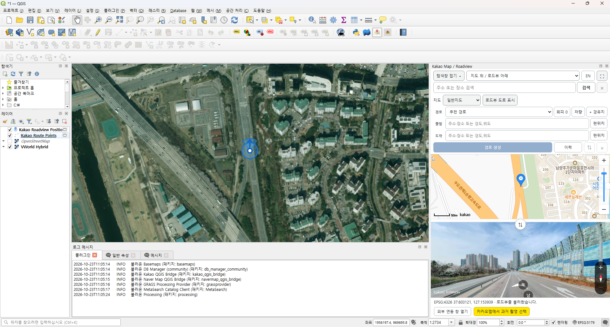

### Layout, splitter, and fullscreen

Choose a layout to place the map and Roadview above/below or beside each other. Drag the splitter to resize the two areas. The button in the middle swaps their positions. The top **⛶** button switches fullscreen mode: dock fullscreen in the embedded viewer, or browser fullscreen in external mode.

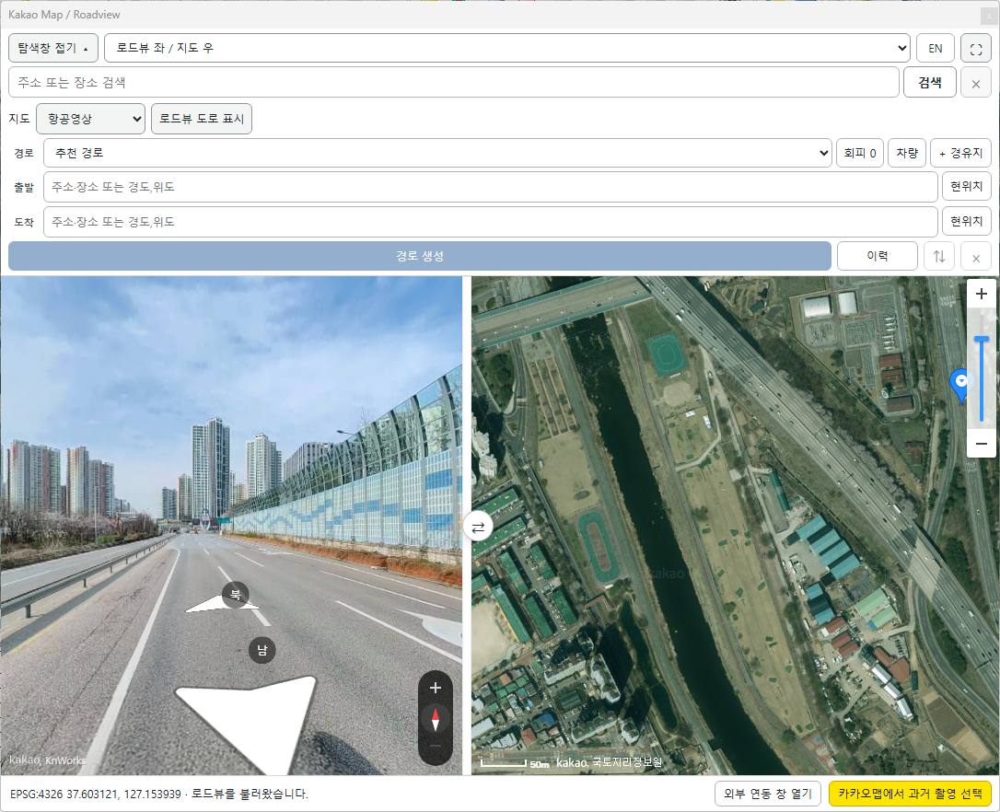

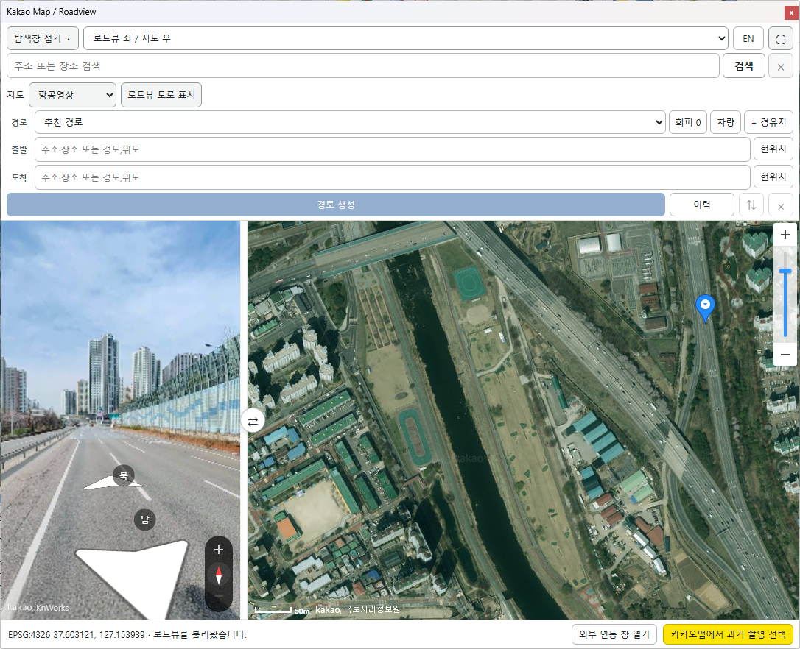

## Maps and search

Enter a place name or address in the search box and select a result to move QGIS, the Kakao map, and Roadview to that location. Collapse and reopen the result list without losing results. A new search expands its results.

Map types are **Roadmap (일반지도)**, **Aerial (항공영상)**, and **Aerial + labels (항공영상+지명)**. **Show Roadview roads (로드뷰 도로 표시)** toggles the road coverage overlay. These controls do not change the QGIS basemap.

QGIS and Kakao Map synchronize panning and zooming in both directions. Zoom-only changes preserve the Roadview panorama position; dragging the map or moving inside Roadview updates the position. Kakao's discrete roadmap levels 1–14 and QGIS scale locking affect zoom matching. See the [zoom and Roadview policy (Korean)](zoom-roadview-policy.md).

## Route inputs and directions

1. Enter an address, place, or coordinates for the origin and destination. Both `longitude,latitude` and `latitude,longitude` are supported, for example `126.9786567,37.566826`.
2. Use **Here (현위치)** to set a point to the map center, or select a search suggestion to confirm its location.
3. Add up to five waypoints with **+ Waypoint (+ 경유지)**. Use the arrows to reorder waypoints or swap the origin and destination.
4. Select **Recommended (추천 경로)**, **Fastest (최단 시간)**, or **Shortest (최단 거리)**, then configure avoidance and vehicle options if needed.
5. Click **Create route (경로 생성)**. Enter your REST API key when prompted on first use.

QGIS displays the temporary layers `Kakao Mobility Route`, `Kakao Route Points`, and `Kakao Route Guidance`. Select a directions item to focus that point in QGIS and the viewer.

Before routing, pins use the input locations. Result pins use the API guidance locations. Original input coordinates remain available for editing, rerouting, and history export. A waypoint result pin is omitted when the response has no corresponding guidance. Small origin/destination/waypoint symbols in the guidance layer are hidden to avoid overlapping the larger Route Points pins.

### Avoidance and vehicle options

Expand **Avoid (회피)** to select toll roads, motorways, ferries, school zones, and U-turns. Multiple selections are allowed. The button count shows the number selected; selecting toll roads and school zones, for example, displays **Avoid 2**.

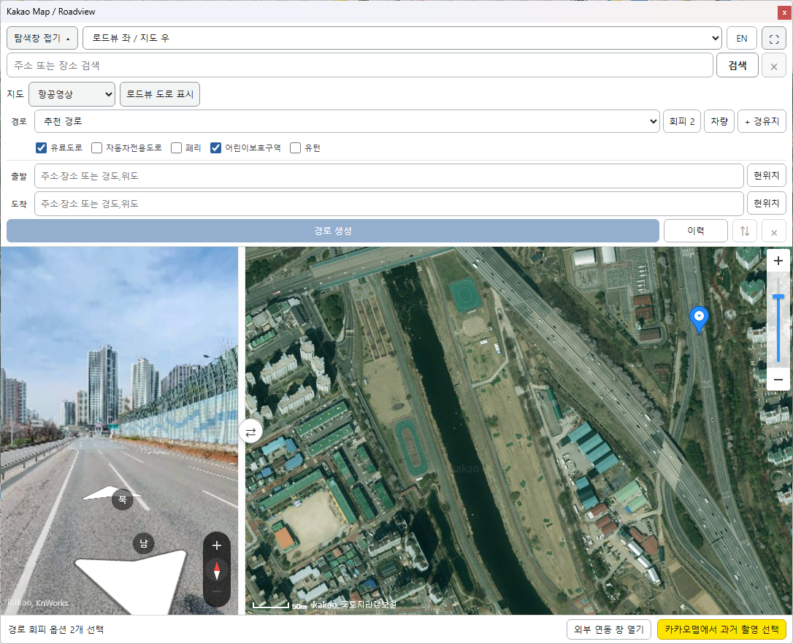

Expand **Vehicle (차량)** to choose a vehicle class: small, medium, large, large truck, special truck, compact, or motorcycle. Set the fuel type to gasoline, diesel, or LPG, and select Hi-pass usage as applicable. Create the route again after changing options to apply them to a new request.

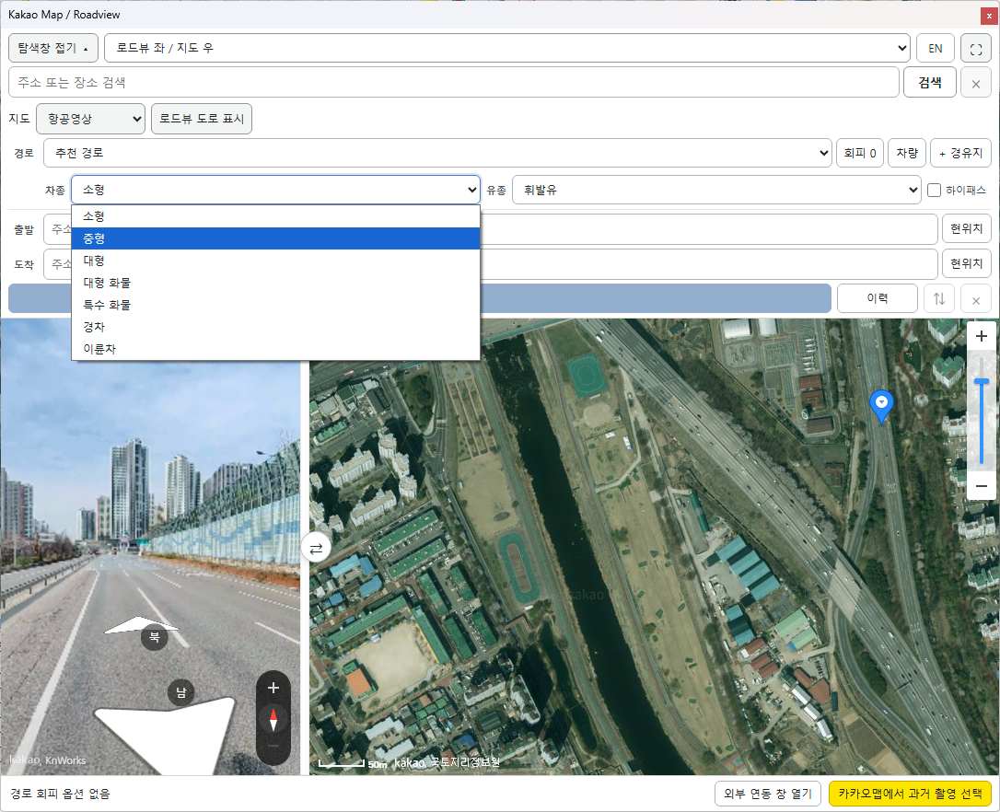

### Clear search versus reset route

The **× beside the search box** clears the search query and results. The **× beside Create route** resets origin/destination/waypoint inputs and the currently displayed route. It does not delete saved session history.

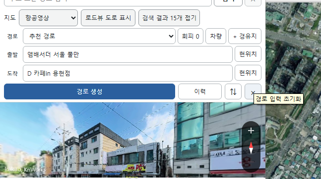

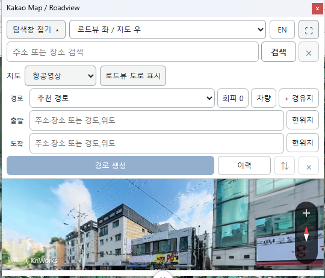

## History and export

Generated routes accumulate in **History (이력)** for the current session. Selecting an item displays its result. **Load (불러오기)** restores its inputs and options. Individual deletion, deletion of all history, selected export, and individual export are available.

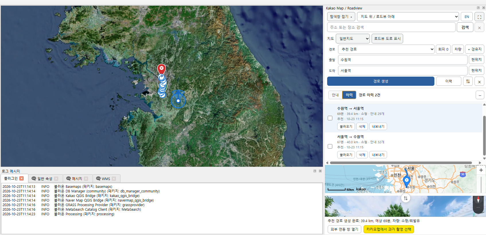

### Export selected history and load it again

1. Select items using their checkboxes. **Select all / Deselect all (전체 선택 / 전체 해제)** changes the selection in one step.
2. Click **Save selected (선택 저장)**, choose a format such as GeoPackage, and specify the output file. Use **Export (내보내기)** under an item to export just that route.
3. After restarting QGIS, use **Load history (이력 불러오기)** or the plugin menu command **경로 이력 불러오기...** to select the saved file.
4. Select a restored item to display its route and directions. Its **Load** action also restores origin, destination, waypoints, and options to the input controls.

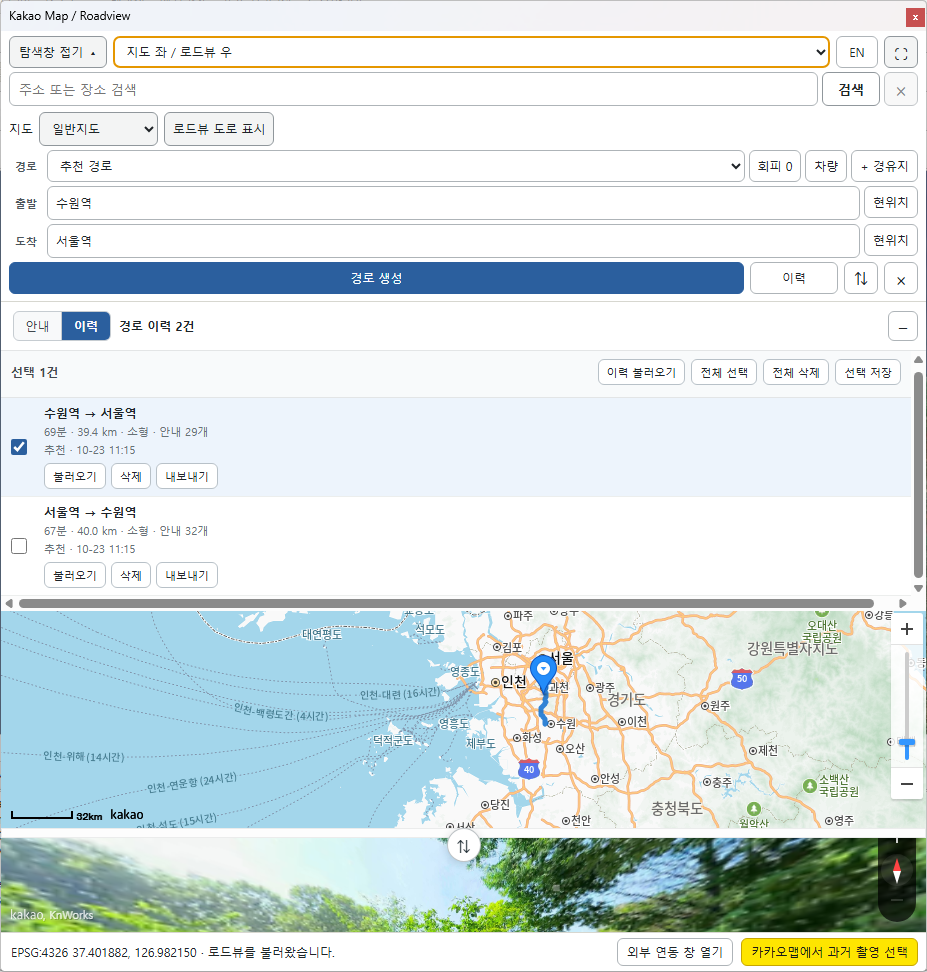

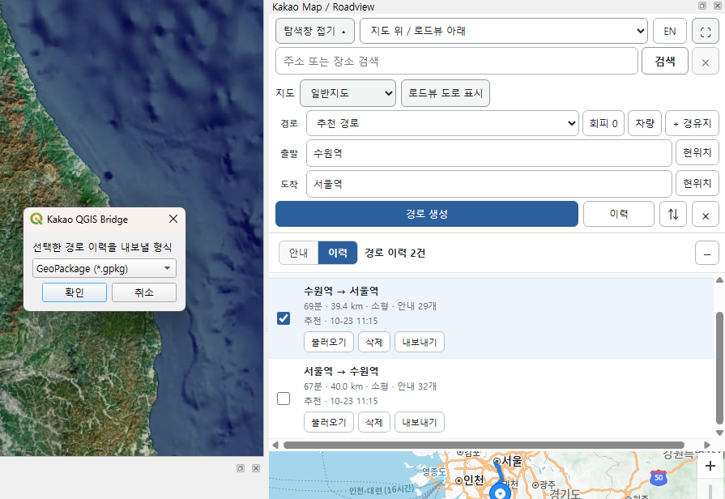

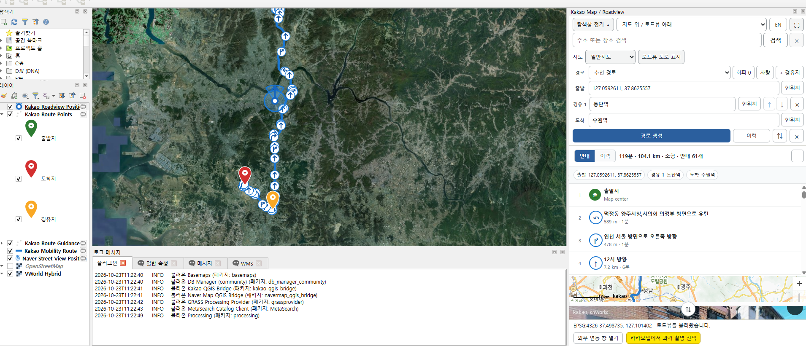

### Delete history

Click **Delete (삭제)** under an item to open a confirmation dialog showing its route name. **Yes (예)** removes that item from the current session; **No (아니요)** cancels. Deleting the currently active history item also clears its route and directions display.

**Delete all (전체 삭제)** removes all session history after a separate confirmation. Checkboxes control selected export; the Delete action under an item targets that item. These actions do not delete files already exported to disk.

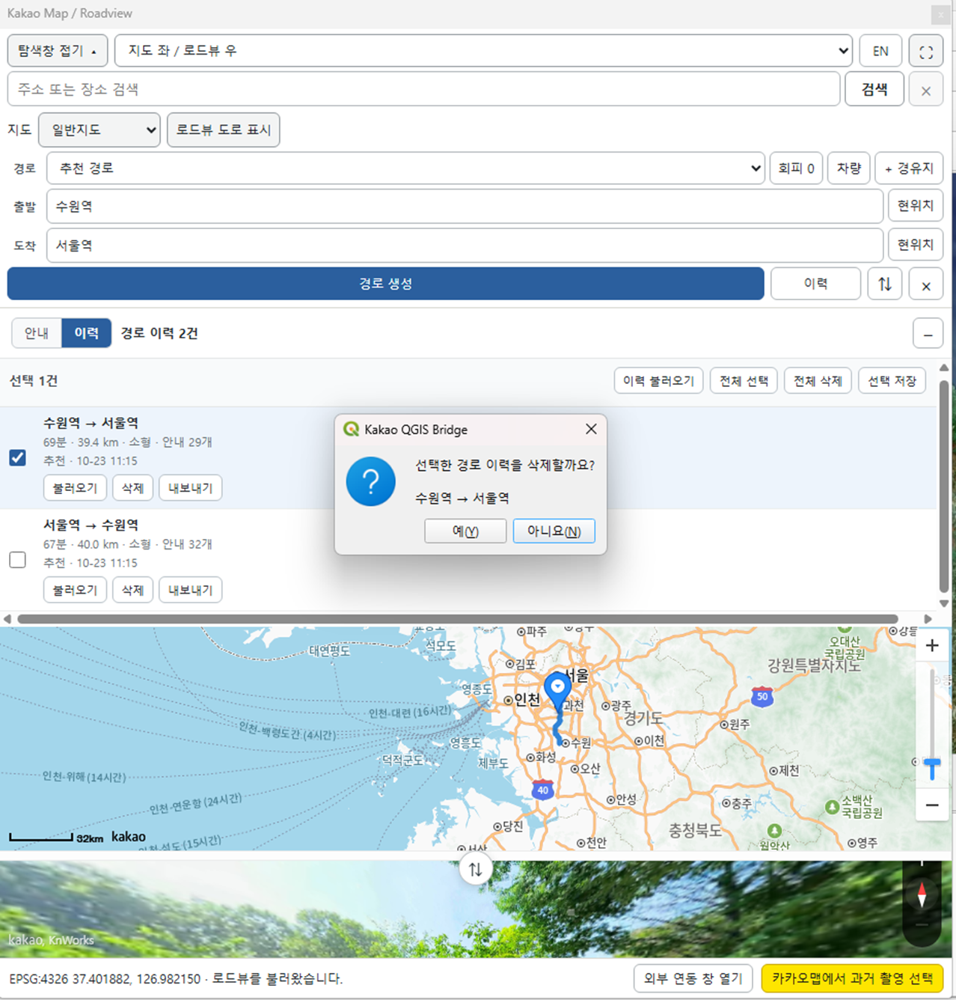

### Formats and session behavior

The QGIS plugin menu can export the whole session to GeoPackage, GeoJSON, Shapefile, or GPX. GeoJSON and Shapefile exports include separate route/directions files and QML styles. If GPX QML files are in the same folder, use **GPX 스타일 적용해서 불러오기...** to load the layers with styles.

History is not saved automatically. Saving again to the same GeoPackage skips existing `history_id` values and appends new history. GeoPackage, GeoJSON, and Shapefile can be imported as history; GPX is loaded as map layers. Imports must pass whole-file checks for CRS, schema, relationships, and conflicting records. See [export validation and format limitations (Korean)](export-validation.md).

Changing the QGIS project resets current displays, inputs, and pending requests, but retains session history. Select a history item to display it in the new project.

## Compare GPKG routes and fares

Use **GPKG 경로 비교...** to open Kakao and Naver route files as A and B. Compare distance, estimated duration, query time, and B−A differences. Display both routes as a blue solid line and an orange dashed line. Original files are not modified.

Origin, destination, and waypoints in visit order are compared using a 20 m tolerance. Matching locations do not establish matching traffic, vehicle, or avoidance conditions. Only stored toll and estimated taxi fare values are compared; missing values are shown as unavailable. See [route comparison (Korean)](route-comparison.md) and [fare comparison (Korean)](fare-comparison.md).

### Compare two routes

1. In **GPKG 경로 비교...**, use **GPKG 열기...** for A and B to open each file.
2. Select a route from each file and check its origin/destination/waypoints, query time, distance, and duration.
3. Click **두 경로 지도에 표시** to display A as a blue solid line and B as an orange dashed line. Use **비교 표시 지우기** to remove the temporary comparison display.

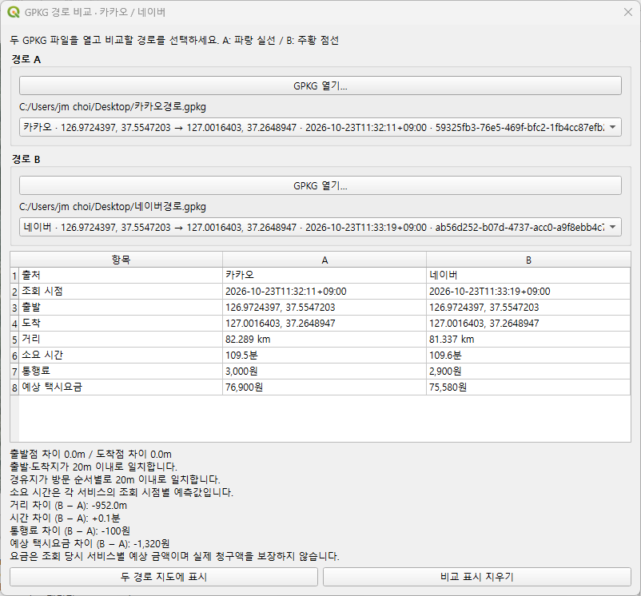

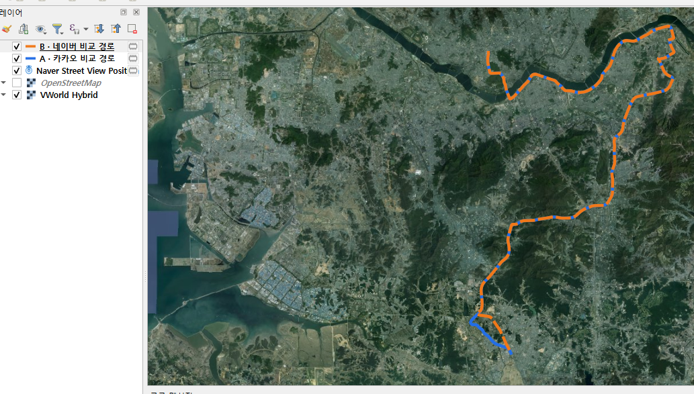

### Read fares and differences

Differences are calculated as **B−A**. Positive means B is larger; negative means B is smaller. In the screenshot, tolls are KRW 3,000 for A and KRW 2,900 for B, so B is KRW 100 lower. Estimated taxi fares are KRW 76,900 for A and KRW 75,580 for B, so B is KRW 1,320 lower. These are the captured query results, not a guarantee of current fares or actual charges.

Older history without fares is shown as unavailable, distinct from zero. Query a new route and export it to a separate file to obtain stored fare values. Do not add tolls to the estimated taxi fare.

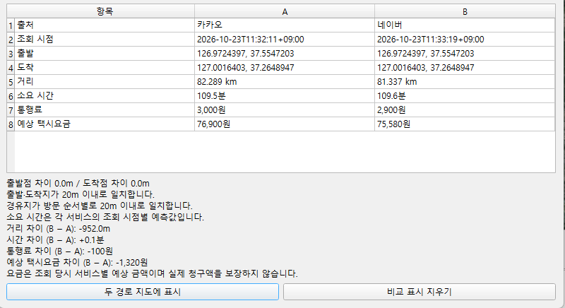

## External browser and historical imagery

If WebEngine/WebChannel is unavailable, use **외부 연동 창 열기**. The footer button also opens an external browser from the embedded viewer. The server tries port 8081 first, then 8082 if it is occupied. Register both origins as JavaScript SDK domains.

Close tabs from older sessions and open a fresh viewer using the plugin button. **Historical imagery in Kakao Map (카카오맵에서 과거 촬영 선택)** opens the official Kakao Map Roadview service. The plugin API does not provide a list of historical panoramas.

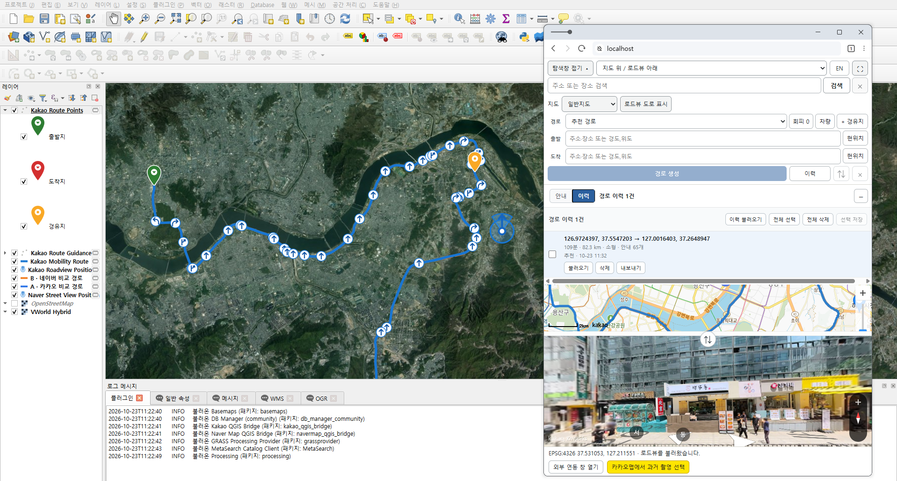

## Troubleshooting connections

- If the map does not load, check the JavaScript key and registered SDK domains. Unless you changed the embedded viewer's base URL, register both localhost:8081 and localhost:8082.
- If the map loads but routing fails, check the REST API key, routing service permissions, and the displayed error.
- If an old external tab reports a connection error, close it and open a new viewer from the current QGIS session.
- If both bridge ports are occupied, close unused QGIS integrations and try again.

See [setup and API keys](guide.en.md) for details. There is no need to change working keys or domains just to reproduce an error screenshot.

## About the screenshots

The guide uses the original version 1.3 screenshots provided on October 23, 2026. Their Korean text is intentionally retained. Control placement varies with window size and layout, and the independent collapse behavior added in 1.3.1 may differ from these screenshots. The [screenshot inventory (Korean)](screenshots/README.md) separates current and older images.
